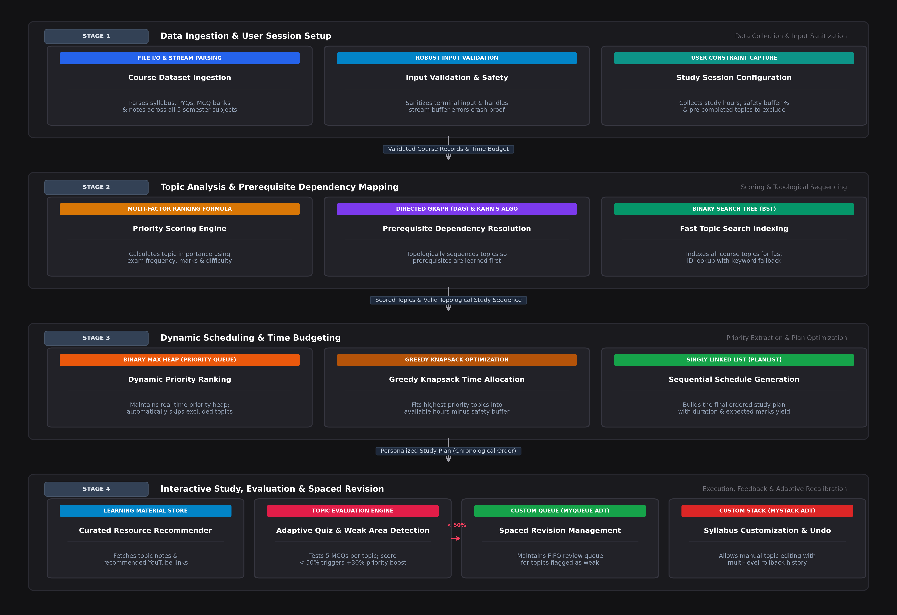

# Smart Study Prioritiser (Phase 3)
> **B.Tech CSE Semester III — Graphic Era Hill University (GEHU)**  
> **Course Code**: TCS302 (Data Structures) & TCS307 (Object Oriented Programming with C++)  
> **Team**: Algo Verse  
> **Members**:
> - Rahul Singh Panwar (Team Lead)
> - Siddharth Saklani
> - Shaurya Singh Kanyal
> - Vedansh Gwari

---

## 📌 Project Overview
The **Smart Study Prioritiser** is an end-to-end algorithmic study planning and preparation engine designed to maximize semester exam yield under strict time constraints. It replaces ad-hoc revision with data-driven prioritization across 5 university courses:
1. **TCS302**: Data Structures with C/C++
2. **TCS307**: Object Oriented Programming with C++
3. **TCS346**: Python Programming
4. **TCS308**: Discrete Mathematics & Graph Theory
5. **TCS392**: Network Security & Cryptography

---

## 🏗️ System Architecture & Workflow
The system operates as an end-to-end 4-stage pipeline connecting data ingestion to dynamic evaluation:



1. **Stage 1: Data Ingestion & User Session Setup**  
   Parses multi-subject flat files (`syllabus`, `pyq`, `quiz`, `notes`) with crash-proof stream validation and captures available study hours, safety buffer %, and pre-completed topics to exclude.
2. **Stage 2: Topic Analysis & Prerequisite Dependency Mapping**  
   Calculates priority scores via multi-factor ranking (Hits, Marks, Density, Difficulty) and establishes foundational prerequisite ordering via a Directed Acyclic Graph (DAG) using Kahn's Topological Sort.
3. **Stage 3: Dynamic Scheduling & Time Budgeting**  
   Ranks topics dynamically using a Binary Max-Heap (automatically skipping prepared topics) and allocates study minutes using a Greedy Knapsack algorithm into a sequential Singly Linked List (`PlanList`).
4. **Stage 4: Interactive Study, Evaluation & Spaced Revision**  
   Recommends curated YouTube links and theory summaries, conducts 5-MCQ evaluation quizzes (< 50% score triggers a +30% priority boost into a FIFO revision queue), and enables multi-level syllabus rollback via a custom LIFO Stack.

---

## 🛠️ Custom Data Structures (Built from Scratch)
In accordance with TCS302 academic guidelines, all core data structures are built from scratch without standard library wrappers (`<stack>`, `<queue>`, `<list>`):
- **Binary Max-Heap (`MaxHeap`)**: $O(\log n)$ priority queue extracting top-yielding exam topics.
- **Binary Search Tree (`TopicBST`)**: Indexed by Topic ID for $O(\log n)$ search with keyword fallback.
- **Directed Graph (`PrereqGraph`)**: Adjacency list DAG supporting Kahn’s Topological Sort, BFS, and DFS traversals.
- **Singly Linked List (`PlanList`)**: Sequential schedule tracker computing cumulative study time and mark yields.
- **Custom Stack (`MyStack<T>`)**: Dynamic node-based LIFO stack powering multi-level syllabus edit undo.
- **Custom Queue (`MyQueue<T>`)**: Dynamic node-based FIFO queue managing spaced topic revision loops.

---

## 🚀 Compilation & Execution

### Prerequisites
- Modern C++ compiler supporting C++17 (`g++`, `clang++`, or `MSVC`).

### Build & Run
```bash
# Compile with C++17 standard
g++ -std=c++17 -Wall prioritiser.cpp -o prioritiser.exe

# Run application
./prioritiser.exe
```

---
*Developed by Team Algo Verse — Graphic Era Hill University*
